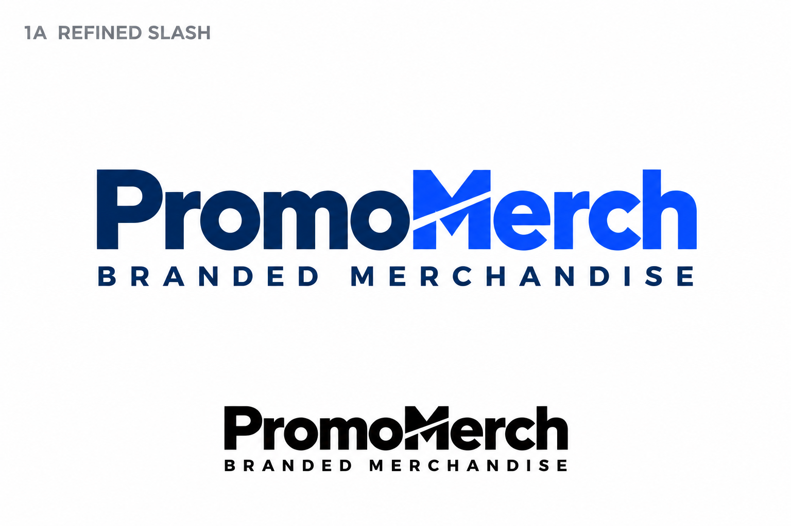

# PromoMerch

Website build specification for **PromoMerch.ca**, the planned new identity for the existing MerchMatters.ca merchandise business.

**Selected identity:** 1A — Refined Slash.  
**Package status:** master prompt and reference assets prepared. Website implementation, deployment, DNS changes and migration have not been performed by this preparation task.

## Start here

1. Read [MASTER_PROMPT.md](MASTER_PROMPT.md), the complete project-specific Codex instruction.
2. Review [AGENTS.md](AGENTS.md) and the [current project status](docs/PROJECT_STATUS.md).
3. Use the selected logo reference and project records when implementing the next authorized build.

The master prompt adapts the actual **Grafov Group Universal Codex Website Launch Master Prompt v2.0**, dated November 4, 2026. The [unchanged original](docs/standards/GRAFOV_GROUP_UNIVERSAL_CODEX_MASTER_PROMPT_v2.md), [alignment map](docs/UNIVERSAL_ALIGNMENT.md) and [source provenance](docs/SOURCE_PROVENANCE.md) are included.

## Build instruction

When ready to implement, give Codex this instruction:

> Read MASTER_PROMPT.md in full and build PromoMerch.ca using its requirements and the selected 1A Refined Slash identity. Use APPROVED_BRAND_BUILD if no implementation exists; otherwise RESUME. Complete the bilingual quote-led website, verify the implemented customer journeys, maintain the project records, and commit/push authorized work to this repository. Continue independent work around unavailable external setup. Keep deployment, DNS changes and the MerchMatters migration within the scope I authorize.

This command is for the next authorized build. Merely storing this package is not a website deployment.

## Business and website direction

- Direct branded merchandise provider serving Canadian businesses, teams, institutions and events.
- Team apparel, event merchandise, corporate gifts and employee kits.
- Quote-led catalogue, multi-product shortlist, project-brief enquiry and reorder path.
- Canadian English and Québec-appropriate French from the first complete release.
- Navy/cobalt wordmark, wide image-rich layouts, uppercase navigation/buttons, rounded buttons and visible EN/FR control.
- Useful reviewed content and geographic coverage, with factual product data and no mass thin location pages.
- Verified form delivery, responsive/accessibility checks, full favicon coverage, source recovery and truthful deployment/search statuses.

## Package

| File | Purpose |
| --- | --- |
| [MASTER_PROMPT.md](MASTER_PROMPT.md) | Full implementation brief |
| [AGENTS.md](AGENTS.md) | Repository working instructions |
| [Universal v2.0 source](docs/standards/GRAFOV_GROUP_UNIVERSAL_CODEX_MASTER_PROMPT_v2.md) | Exact inherited baseline |
| [UNIVERSAL_ALIGNMENT.md](docs/UNIVERSAL_ALIGNMENT.md) | Mapping and brand-specific overrides |
| [PROJECT_BRIEF.md](docs/PROJECT_BRIEF.md) | Commercial model and known/unknown facts |
| [BRAND_GUIDE.md](docs/BRAND_GUIDE.md) | Selected identity and production asset requirements |
| [DECISIONS.md](docs/DECISIONS.md) | Owner decisions and implementation defaults |
| [MERCHMATTERS_MIGRATION.md](docs/MERCHMATTERS_MIGRATION.md) | Transition procedure and readiness record |
| [PROJECT_STATUS.md](docs/PROJECT_STATUS.md) | Actual state and resume point |
| [SOURCE_PROVENANCE.md](docs/SOURCE_PROVENANCE.md) | Version, source and integrity record |

## Selected visual reference

The image is the unchanged selected **raster concept board**. It includes a presentation title, white background and smaller monochrome sample. It is not a transparent production logo or a vector asset. The build must create faithful production variants while preserving this source.

## External setup to verify during the build

The intended contacts are **info@promomerch.ca** and **(833) 696-9996**. Domain control, hosting, mailbox operation, form endpoint, supplier/product records and legal details still need relevant verification. Existing MerchMatters contact and legal statements are recorded for transition planning.

There is no application runtime or build command yet: this repository starts with the approved build brief and assets. Add actual setup/build/deployment instructions when implementation exists. Do not report the website live from the presence of this package.

