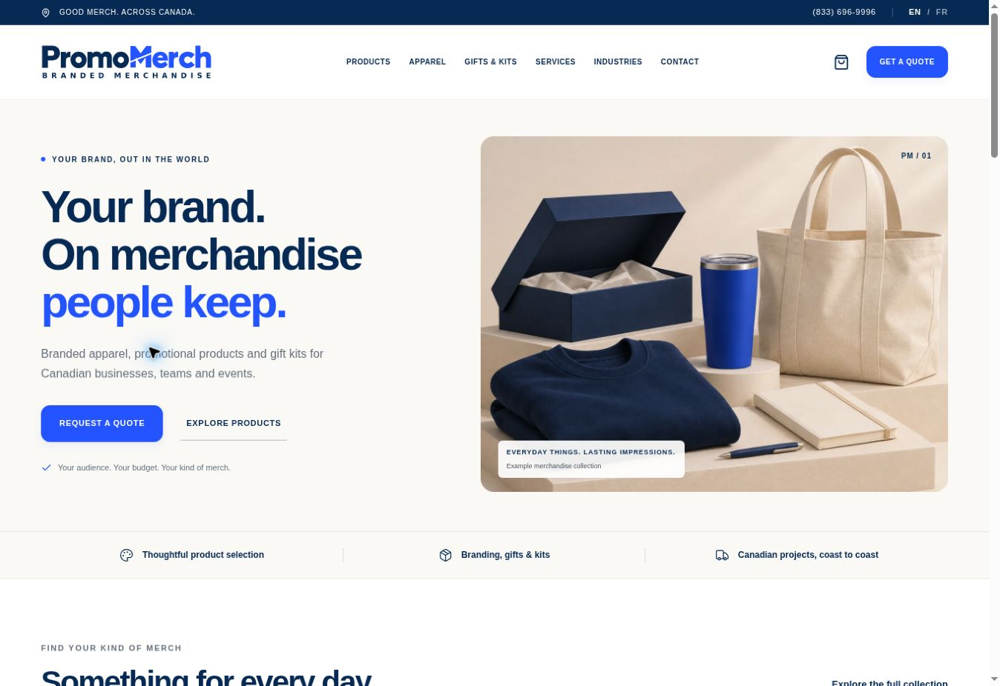

# Build validation

This record describes the checks performed for the first private review build. It distinguishes source/local evidence from hosted publication. It is not an accessibility certification, a synthetic performance score or proof of mailbox delivery.

## Source and build checks

| Check | Result | Evidence / limit |
| --- | --- | --- |
| TypeScript | PASS | Full project `tsc --noEmit` |
| Application lint | PASS | ESLint application and core data/route files; stylistic framework image warnings do not imply broken images |
| Production compilation | PASS | Sites build helper / five-stage Vinext build; see final publication record for the packaged commit |
| Quote regression suite | PASS | 15 tests in scripts/test-quote.mjs |
| Route graph | PASS | 98 unique paths, 49 reciprocal EN/FR pairs, four unknown/unsupported paths rejected |
| Content completeness | PASS | 24 product families, four in each of six categories; 14 bilingual supporting page records |
| Internal route mapping | PASS | Navigation, footer, guides, service links and content slugs checked against the resolver |
| Asset integrity | PASS | Original concept board preserved; generated originals and optimized derivatives inventoried in MEDIA_MANIFEST.md |
| Real favicon containers | PASS | SVG, PNG, Apple touch assets and genuine ICO sizes checked |

The quote tests cover field boundaries, consent, quantities, Canadian postal codes, date-only validation in Toronto, budgets, honeypots, timing, French errors, file signature/extension checks, active-PDF rejection, size limits, early persistent limiting, idempotent retries and ambiguous-write artwork ownership.

## Browser checks in the managed preview

Checked in the actual browser using the managed Sites preview. Desktop viewport was 1363 × 936; responsive previews used embedded 390 × 844 and 768 × 844 viewports. These are responsive viewport checks, not claims of testing physical phones or all browsers.

- English homepage: selected colour lockup, aligned descriptor, hero composition, image rendering and direct quote/catalogue actions.
- French page metadata and `html lang=fr-CA`; English uses `en-CA`. Equivalent catalogue and quote links preserve the page purpose.
- Catalogue search returned matching families; adding a bottle updated the quote list.
- The shortlist survived an English-to-French page change. Quantity was edited from 50 to 75 in the French form.
- Empty French submission produced field-level errors and a focused error summary without discarding the shortlist.
- A labelled synthetic French request completed with a saved-reference confirmation. A local D1 query confirmed the same reference, locale, received status, quantity 75 and marketing consent off.
- A labelled synthetic English brief was submitted through the mobile layout with a 722-byte PNG attachment. The local row recorded the reference, attachment length and `quarantined_unreviewed` status.
- Both accepted test records retained `notification_status=not_configured`. No outbound email or order was asserted.
- Mobile menu opened, contained navigation/quote links, and closed with Escape. Form controls, consent and upload controls fit the checked narrow viewport.
- Representative product detail page displayed the family qualifier, editable quantity, add action, related ideas and enquiry link.
- After the final configuration reload, product URLs retained their canonical trailing slash. The French missing-page view was localized and carried noindex metadata. robots.txt returned Disallow: / and sitemap.xml contained an empty URL set for private review. Shared icon links were present on the product template.

Test records and runtime storage remain outside Git and deployment source. No real customer's personal information or artwork was used.

## Scope limits and launch work

- Browser extension metadata warnings were observed separately from the application; no application failure was inferred from those extension messages.
- The managed preview's loopback address is browser-only in this environment; ordinary executor HTTP requests cannot reach it. The route graph and browser checks are not labelled a full HTTP crawler run.
- No independent WCAG conformance audit, assistive-technology matrix, Lighthouse/Core Web Vitals claim or broad load test has been performed.
- File checks are admission controls. Artwork remains quarantined; there is no malware scanning or public file-read endpoint.
- Email provider acceptance, delivery events and actual owner/customer inbox receipt remain untested because no provider is configured.
- Hosted persistence, deployment success and current source commit must be read from their actual release records. Local checks do not establish these outcomes.
- Actual phone/mail routing, seller details, retention, backup/recovery and operator access need launch confirmation.
- Public product data and live SKU imagery need supplier verification; generated collection images do not verify availability.

## Captured review views

